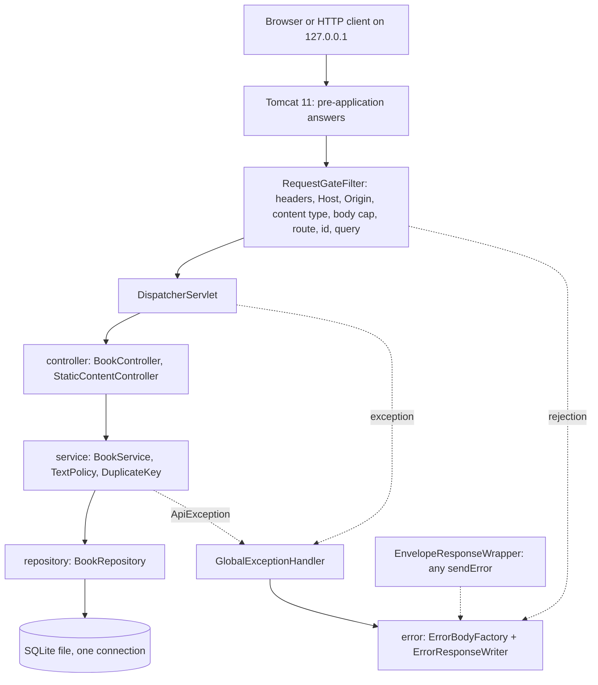

# Handoff 020: Backend plan (Phase 3)
- From: java
- To: liaison
- Phase: 3   Round: 1 of 3
- Artifacts: `docs/sdd/constitution.md` v1.0, `docs/sdd/spec.md` v0.4.1, `docs/sdd/security.md` 0.15, `docs/sdd/delivery-strategy.md` v1.0; target: the backend section of `docs/sdd/plan.md` (merged by the orchestrator with the frontend section) and the input of `tasks.md` (part 8)
- Type: REVIEW_REQUEST

## Summary
Parts 1 to 7 below are written to be pasted into `plan.md` as the backend section (they follow the exercise template numbering). Part 8 is the increment map for the PM (it feeds `tasks.md`, not `plan.md`). No application code was written and no file other than this handoff was edited. Nothing in the plan needs a dependency outside the approved list. Four items need a Sponsor decision at this gate (schema, one static-content decision, one package-layout decision, and the effort estimate): see "Open items".

## Content

# Backend plan (plan.md section)

## 1. Architecture overview



**Decisions and rationale**
- Layers and direction follow the constitution (controller, service, repository, domain, dto, error, config). Services throw `ApiException` subclasses that carry an `ErrorCode` (wire code and numeric status, no HTTP types); only the advice, the filter and the wrapper turn them into responses.
- **One transport filter (`RequestGateFilter`) decides everything that BR-012 steps 1 to 4 and the first part of step 5 require.** Reason: the container normalizes `//`, `;` parameters and dot segments before Spring maps a route, so only the raw request target (`getRequestURI()`, undecoded) can tell `/api/v1/books/%2e%2e` or `/api/v1/books;x=1` from a valid path (spec 5.0, E-01, E-24, E-24b; security note "judge the raw request target"). Spring then only sees requests that already passed, with a buffered body and a normalized `Accept`.
- **Static content is served by `StaticContentController` from an immutable catalog** built at startup from `classpath:/static/` (the value of `spring.web.resources.static-locations`), and Spring's default resource handler is switched off (`spring.web.resources.add-mappings: false`). Reason: the default handler adds `Last-Modified`, `ETag`, `Accept-Ranges`, answers `Range` with 206 and conditional requests with 304; spec 5.8 and E-30 forbid all of them and there is no switch to turn them off. The catalog also gives "a fixed, finite set of paths" and 404 for everything else without a traversal surface.
- Time and ids: one `Clock` bean (the only place that names a clock, in `ClockConfig`), instants truncated to milliseconds before they are stored or returned; ids by `IdGenerator` (UUID v4, lowercase) in the service layer, injectable for tests.

**Package layout under `com.globant.globerbooks`** (no sub-packages; see assumption A-01)

| Package | Class | Responsibility |
|---|---|---|
| (root) | `GloberBooksApplication` | Entry point; excludes `ErrorMvcAutoConfiguration` |
| controller | `BookController` | Seven book endpoints: binding, status codes, DTO mapping only |
| | `StaticContentController` | Serves catalog entries for `GET /`, `/index.html` and the assets |
| service | `BookService` | All use cases; one `@Transactional` method per use case; capacity, duplicate, status and rating rules |
| | `TextPolicy` | BR-006: trim by Unicode White_Space, NFC, code-point length, category rules, mark runs, joiners; returns a problem enum, no framework types |
| | `DuplicateKey` | BR-003 key: NFKC, lower case (`Locale.ROOT`), whitespace runs collapsed, trim; ASCII and already-normalized fast path |
| | `IdGenerator` | UUID v4 text |
| repository | `BookRepository` | Spring Data interface: find, count, delete, ordered list, ordered key-row stream |
| | `BookKeyRow` | Record projection (id, title, author, date_added) for the duplicate scan |
| domain | `Book` | Entity; no public setters; methods `changeStatus`, `assignRating`, `clearRating` keep INV-1 to INV-4 |
| | `BookStatus` | Enum with wire value, `fromWire` returning `Optional`, nested JPA converter that stores the lower-case text |
| | `InstantTextConverter` | JPA converter, fixed format `yyyy-MM-dd'T'HH:mm:ss.SSS'Z'` |
| dto | `CreateBookRequest`, `StatusRequest`, `RatingRequest` | Request records; `RatingValue` (record) carries the judged rating literal |
| | `BookResponse`, `BookListResponse` | Response records (seven members; `books`, `total`) |
| error | `ErrorCode` | Enum of all 16 codes with HTTP status and informative text (Appendix A) |
| | `ApiException`, `DuplicateBookException` | Base exception (code, optional details) and the one with the existing book |
| | `ErrorBody`, `DuplicateErrorBody`, `FieldProblem` | Envelope records (two body records instead of a `details` field of type `Object`, which SC-08 forbids) |
| | `ErrorBodyFactory`, `ErrorResponseWriter` | The single factory; the writer used by filter and wrapper |
| | `GlobalExceptionHandler` | `@RestControllerAdvice`: validation, parse, framework and catch-all exceptions, explicit JSON content type |
| config | `RequestGateFilter`, `RouteTable`, `RequestTarget` | Filter at highest precedence; route and method table; raw-target parser |
| | `ClientOriginPolicy`, `ContentTypePolicy`, `AcceptPolicy`, `QueryPolicy` | Host / Origin / Sec-Fetch-Site; Content-Type grammar; Accept grammar; query grammar and `status` value |
| | `BoundedBodyRequest`, `SecurityHeaders`, `EnvelopeResponseWrapper` | Capped buffered body (fixes `Accept`, no further reads); header set; converts any `sendError` into an envelope |
| | `StrictJsonBodyResolver`, `StrictStringDeserializer`, `RatingValueDeserializer`, `JacksonConfig`, `WebMvcConfig`, `ValidatorConfig` | Strict UTF-8 decode then strict parse into a DTO; unpaired-surrogate check; rating literal judgement; read constraints; wiring; `ParameterMessageInterpolator` (no EL) |
| | `BookText` (annotation), `BookTextValidator` | Bean Validation constraint that delegates to `TextPolicy` |
| | `StartupPolicy`, `DataDirectoryGuard`, `StoredLibraryValidator`, `SqliteDataSourceConfig`, `StartupFailureAnalyzer` | Fail-closed start (SC-39), directory and file trust (US-009.6), stored-data validation (US-009.5), single pooled connection with pragmas and claim (US-009.7), clean console reason |
| | `StaticAssetCatalog`, `ClockConfig` | Fixed set of served paths; the `Clock` bean |

Classes whose name ends in `Config` hold no logic and are the only JaCoCo exclusions besides `GloberBooksApplication`; every other `config` class counts toward coverage.

**Request pipeline** (BR-012). Failure at a stage ends the request through the error-body factory; later stages do not run.

| # | Stage | Where | Failure |
|---|---|---|---|
| 0 | Request line / header parsing, 8 KiB header, duplicate Host, bad Content-Length, TRACE | Tomcat | pre-application answer (400, 405, 414, 431, 501, 505), empty body, no product |
| 1 | Security headers set on the response (re-applied on `reset` and `sendError`) | gate | none |
| 2 | Host: raw header lower-cased equals `localhost:<port>` or `127.0.0.1:<port>` (`<port>` = `getLocalPort()`); `[::1]:<port>` only when bound to `::1`; absent or repeated Host fails | gate | 400 `INVALID_HOST` |
| 3 | `Origin` then `Sec-Fetch-Site` | gate | 403 `FORBIDDEN` |
| 4 | Content-Type grammar (every method except GET and HEAD, also without body) | gate | 415 |
| 5 | Body cap 16,384: declared length checked before any read (so `Expect: 100-continue` never gets `100`); chunked and unread bodies are read by the gate into a buffer and stopped at byte 16,385; `Connection: close` on early rejection | gate | 413 |
| 6 | Route and method from the raw target (404, then 405 with exact `Allow`), then `Accept` on `/api/v1/` paths | gate | 404, 405, 406 |
| 7 | Id format (raw segment, lowercase 36-character UUID) | gate | 400 `MALFORMED_REQUEST` |
| 8 | Query grammar and, on the list, the `status` value (decoded value passed on as a request attribute) | gate | 400 `MALFORMED_REQUEST`, `INVALID_STATUS` |
| 9 | Body bytes on GET or DELETE | gate | 400 `MALFORMED_REQUEST` |
| 10 | Strict decode (UTF-8, reporting) and parse; unknown, duplicate, wrong-type, surrogate, limits | `StrictJsonBodyResolver` | 400 `MALFORMED_REQUEST` |
| 11 | Field values (Bean Validation, code points) | MVC argument validation | 400 `VALIDATION_ERROR`, `INVALID_STATUS`, `INVALID_RATING` |
| 12 | Existence, then `RATING_NOT_ALLOWED`, `LIBRARY_FULL`, `DUPLICATE_BOOK` (service re-checks stages 11 first) | `BookService` | 404, 400, 409 |

Spring's `CharacterEncodingFilter` is disabled (`server.servlet.encoding.enabled: false`) so the gate is first. The gate never calls `getParameter*` (Tomcat would parse and the hidden-method and form filters are off anyway).

**Error-body factory use.** `ErrorBodyFactory` builds the body (code, informative text, `Clock` timestamp, optional details). Used by: `GlobalExceptionHandler` (controller, validation, parse and framework exceptions, catch-all `Exception` which logs the stack trace once and answers `INTERNAL_ERROR`); `RequestGateFilter` through `ErrorResponseWriter` (stages 2 to 9, plus a `catch Throwable` around the chain); `EnvelopeResponseWrapper` (any `sendError` from inside the application: the "container error path"). `ErrorMvcAutoConfiguration` is excluded so `/error` does not exist. Answers Tomcat gives before the application runs stay generic (R-13); if a `sendError` escapes the wrapper, Task B-12 adds a Tomcat `ErrorReportValve` subclass that uses the factory (Tomcat API, no new dependency).

**Transactions and concurrency.**
- The pool has one connection (mandatory) held for the whole `@Transactional` service method; reads use `readOnly = true`. The driver starts every transaction as `BEGIN IMMEDIATE`. Add is count, optional duplicate scan and insert inside one transaction: atomic by construction (BR-009, BR-013, INV-5, INV-7, C-06 to C-10). `open-in-view` is off and the list releases the connection before JSON is written, so slow clients never hold it.
- Status change and rating change load the book, call a domain method and commit; two concurrent calls run one after the other, last write wins (DEC-018, S-08, S-09). `Book.changeStatus` clears rating and `date_completed` together when leaving `completed` (BR-004) and sets `date_completed` from the injected clock on entering it (BR-008); `assignRating` refuses a non-completed book; the schema CHECKs repeat the invariants (defense in depth).
- Limits that protect the single connection: Tomcat `threads.max: 8`, `threads.min-spare: 2`, `max-connections: 128`, `accept-count: 128`, `max-swallow-size: 64KB`; Hikari `connection-timeout: 5000`. At most eight requests wait for the connection, so the longest wait is about eight database operations (well under 5 s at 5,000 books); the rest queue in the operating system backlog, not in Hikari (see risk X-03).
- Failure injection for E-21 and S-10 needs no production seam: the test creates a `BEFORE UPDATE` or `BEFORE INSERT` trigger that raises on its own temporary database through the application's `DataSource`.

## 2. Technology justification

| Item | Use | Constitution | Action |
|---|---|---|---|
| `spring-boot-starter-webmvc`, `-validation`, `-data-jpa` (4.1.2) | MVC, Bean Validation (Hibernate Validator), JPA, HikariCP | approved list | none |
| `org.xerial:sqlite-jdbc`, `hibernate-community-dialects` | SQLite driver and dialect | approved list | none |
| `spring-boot-starter-webmvc-test`, `-data-jpa-test` | JUnit, Mockito, AssertJ, MockMvc, `@DataJpaTest`, JSON path | approved list | none |
| JDK `java.net.http.HttpClient`, `java.net.Socket`, `ProcessBuilder` (test code only) | Real-port HTTP, raw-socket cases, restart and kill tests | JDK, not a dependency | none (SC-27 greps `backend/src/main` only) |
| Parent plugins: compiler (`-Xlint:all -Werror`, `--release 21`), resources (`frontend/` entry, filtering off, test files excluded), Surefire, Failsafe, Boot plugin | Build | approved list | Failsafe executions `integration-test` and `verify` declared explicitly |
| `jacoco-maven-plugin` 0.8.16 | `prepare-agent` and `prepare-agent-integration`, `merge`, `report`, `check` at `verify`, line ≥ 80 % | approved, pinned | none |
| `maven-checkstyle-plugin` 3.6.0 with Checkstyle 14.3.0 | Naming (3 characters, `id` exception), 300 and 50 line limits, imports, Javadoc, line length, regex bans for wall-clock calls, `System.out`, `printStackTrace`, `select *` | approved, unverified together | Task B-02 verifies or the Sponsor re-approves |
| `spotbugs-maven-plugin` with `findsecbugs-plugin` | Static analysis (SC-07, SC-14, SC-27) | approved, **pin chosen at Task 1** | B-02: read the newest releases on Central, check publishers (`com.github.spotbugs`, `com.h3xstream.findsecbugs`) and Java 21 / class-file 65 support, bind `check` to `verify`, write the pins into the constitution table. Exclusions only in a committed `backend/config/spotbugs/` file with a justification per entry |
| `tomcat-embed-el` or any other transitive artifact | Brought by the starters | transitive | Task B-01 commits the real `dependency:tree`; anything outside it and outside the constitution's exception list is a finding. No new dependency is requested |

ASK FIRST items found: **none for dependencies or plugins.** `maven-enforcer-plugin` stays unapproved; the ban list is checked by `dependency:tree` plus a unit test that looks for banned classes on the runtime classpath (`RuntimeClasspathBanTest`). Decisions that touch "architectural pattern" or "project structure" are listed under Open items (S-2, S-3).

## 3. Folder structure of `backend/`

```
backend/
  pom.xml  mvnw  mvnw.cmd
  .mvn/maven.config                  --strict-checksums
  .mvn/wrapper/maven-wrapper.properties   wrapper 3.3.4, Maven 3.9.16, distributionSha256Sum
  config/checkstyle/                 checkstyle.xml, suppressions.xml (ClockConfig only for the clock regex)
  config/spotbugs/                   exclude.xml (justified entries only)
  src/main/java/com/globant/globerbooks/{controller,service,repository,domain,dto,error,config}
  src/main/resources/                application.yml, schema.sql
  src/test/java/com/globant/globerbooks/   mirrors main; test-only support in support/ (RawHttpClient, AppProcess, LibrarySeeder, UnicodeFixtures, MutableClock, FaultInjection)
  data/                              runtime directory, created 0700, git-ignored
```
`src/test/resources` holds no configuration file: tests override properties in code (`@DynamicPropertySource`, `ApplicationContextRunner`), because `.gitignore` hides `application-*.yml` (SEC-F-036). Test classes: `[Class]Test` (Surefire) and `[Class]IntegrationTest` (Failsafe). Naming: Java conventions of the constitution; wire names snake_case through the mapper only.

## 4. Data model and schema

One entity, one table (spec Section 4). Timestamps are stored as fixed-format UTF text (lexical order equals time order, which the list order relies on). Status is stored as the lower-case wire text.

**Proposed `schema.sql`** (executed at every start, idempotent; the Sponsor approves it at this gate)

```sql
CREATE TABLE IF NOT EXISTS books (
    id             TEXT    NOT NULL PRIMARY KEY,
    title          TEXT    NOT NULL,
    author         TEXT    NOT NULL,
    status         TEXT    NOT NULL,
    rating         INTEGER,
    date_added     TEXT    NOT NULL,
    date_completed TEXT,
    CONSTRAINT ck_books_id CHECK (
        length(id) = 36 AND length(replace(id, '-', '')) = 32
        AND substr(id, 9, 1) = '-' AND substr(id, 14, 1) = '-'
        AND substr(id, 19, 1) = '-' AND substr(id, 24, 1) = '-'
        AND id NOT GLOB '*[^0-9a-f-]*'),
    CONSTRAINT ck_books_title CHECK (length(title) BETWEEN 1 AND 500),
    CONSTRAINT ck_books_author CHECK (length(author) BETWEEN 1 AND 200),
    CONSTRAINT ck_books_status CHECK (status IN ('unread', 'reading', 'completed')),
    CONSTRAINT ck_books_rating CHECK (rating IS NULL OR (rating BETWEEN 1 AND 5 AND status = 'completed')),
    CONSTRAINT ck_books_completed CHECK ((status = 'completed') = (date_completed IS NOT NULL)),
    CONSTRAINT ck_books_added CHECK (length(date_added) = 24 AND date_added GLOB
        '[0-9][0-9][0-9][0-9]-[0-9][0-9]-[0-9][0-9]T[0-9][0-9]:[0-9][0-9]:[0-9][0-9].[0-9][0-9][0-9]Z'),
    CONSTRAINT ck_books_done CHECK (date_completed IS NULL OR (length(date_completed) = 24 AND date_completed GLOB
        '[0-9][0-9][0-9][0-9]-[0-9][0-9]-[0-9][0-9]T[0-9][0-9]:[0-9][0-9]:[0-9][0-9].[0-9][0-9][0-9]Z'))
) STRICT;
```

| Decision | Choice | Reason |
|---|---|---|
| STRICT | yes (SQLite 3.53.4 ≥ 3.37) | Type affinity cannot store text in `rating` |
| Lengths | SQLite `length()` counts code points for text without NUL, the unit of BR-006 | Matches the spec count; NFC and trimming remain the service's job |
| Invariants | INV-1 to INV-4 as CHECKs | Backstop for a service defect and the base of the stored-data validation of US-009.5 |
| Indexes | **none besides the primary key** | At most 5,000 rows: list sort and status filter are trivial scans; the duplicate scan reads every row anyway |
| Comparison key | **computed in Java, not stored** | Constitution: computed in Java; a stored key is a schema change. The scan streams `BookKeyRow` ordered by `date_added`, `id` (so the first match is the earliest, DEC-005), normalizes with the fast path, stops at the first match; one query, no query in a loop |
| Capacity trigger | **none** | US-009.5 makes any trigger invalid, so our own trigger would make our own database invalid. Capacity is protected by the single connection and the immediate transaction |
| Fallback if C-11 fails | Two key columns plus a composite index | Schema change and a validator rule; Sponsor decision then, never silently |
| Entity mapping | `Instant` fields through `InstantTextConverter`, `BookStatus` through its converter, `Persistable` not used (one extra primary-key select per insert is accepted) | Keeps the domain typed; `ddl-auto: validate` must accept STRICT and CHECK (risk X-06, proven in B-05) |

**SQLite connection settings** (compiled into `SqliteDataSourceConfig`, not environment-overridable, written into the final URL after the configured path is validated as `jdbc:sqlite:<file>`)

| Setting | Value | Reason |
|---|---|---|
| `journal_mode` | `WAL` | A committed write survives a killed process (DEC-019, M-3); loss on power failure is the stated limit (US-009.4) |
| `synchronous` | `NORMAL` | Process-kill safe in WAL; `FULL` costs a flush per commit and buys only power-loss safety, which is out of scope |
| `locking_mode` | `EXCLUSIVE`, claim taken by a write transaction at startup | US-009.7: the claim exists from before the first query until stop; a second instance fails with `database is locked`. Side effect: no other tool can open the file while the application runs |
| `transaction_mode` | `IMMEDIATE` | Every transaction takes the write lock at its start (security note "immediate write lock") |
| `foreign_keys` | `ON` | Constitution list; no foreign key exists |
| `busy_timeout` | 5000 ms | Equals the Hikari connection timeout |
| `trusted_schema` | `OFF` (single `connection-init-sql` statement) | SC-32 |
| Extension loading | disabled (driver default); a test asserts `load_extension` fails | Constitution |
| Open mode | read-write without create (the file is pre-created) | A path swap cannot silently create another database |
| Pool | `maximum-pool-size: 1`, `max-lifetime: 0`, `connection-timeout: 5000` | A recycled connection would drop the claim, so lifetime is unlimited |
| Native library directory | `org.sqlite.tmpdir` set to `<data dir>/tmp` (0700) before the first driver use (POSIX) | SC-32 private temp directory on shared machines |

**Startup order (US-009.3, .5, .6, SC-13, SC-39), all before any request is accepted.** (1) `StartupPolicy` refuses a non-loopback `server.address` and any datasource URL that is not `jdbc:sqlite:<file>` (`:memory:`, `:resource:`, parameters, other schemes). (2) `DataDirectoryGuard`: create a missing directory 0700 and a missing file 0600 (POSIX attribute at creation); refuse a symbolic link (no-follow attribute read), another owner (compared with the owner of a file the process just created) or any group or other permission bit; remember the `fileKey` and compare it after the pool opens (detects a swap). Not checked on Windows (stated platform limit). (3) If the file is non-empty: `StoredLibraryValidator` opens it read-only on a separate connection, before `schema.sql` and before WAL is entered, so an invalid file keeps its bytes (US-009.5): exactly one table `books` with the expected columns, no view, trigger or virtual table, every row valid (id, timestamp format, status, rating, lengths in code points, INV-1 to INV-4), at most 5,000 rows. (4) Pool and claim, then `schema.sql`, then Hibernate `validate`. Any refusal throws one exception whose message holds a fixed reason; `StartupFailureAnalyzer` prints it without book data and the process exits non-zero.

## 5. API implementation plan

| Endpoint | Method in `BookController` | Request record (validation) | Success | Errors produced here |
|---|---|---|---|---|
| `GET /api/v1/books` | `list` | none; `status` already judged by the gate | 200 `BookListResponse` | `MALFORMED_REQUEST`, `INVALID_STATUS` (gate) |
| `POST /api/v1/books` | `create` | `CreateBookRequest(title, author, status, allowDuplicate)`: `@BookText` on title (500) and author (200); `status` string with `Nulls.AS_EMPTY` (absent means `unread`, explicit `null` means invalid); `allowDuplicate` as `Boolean` with `Nulls.FAIL` | 201 `BookResponse` | `VALIDATION_ERROR`, `INVALID_STATUS`, `MALFORMED_REQUEST`, `DUPLICATE_BOOK`, `LIBRARY_FULL` |
| `GET /api/v1/books/{id}` | `get` | none | 200 | `BOOK_NOT_FOUND`, `MALFORMED_REQUEST` |
| `DELETE /api/v1/books/{id}` | `delete` | none (body check in the gate) | 200 deleted book | same |
| `PUT /api/v1/books/{id}/status` | `changeStatus` | `StatusRequest(status)` | 200 | `INVALID_STATUS`, `MALFORMED_REQUEST`, `BOOK_NOT_FOUND` |
| `PUT /api/v1/books/{id}/rating` | `setRating` | `RatingRequest(rating)` with `RatingValue` | 200 | `INVALID_RATING`, `RATING_NOT_ALLOWED`, `MALFORMED_REQUEST`, `BOOK_NOT_FOUND` |
| `DELETE /api/v1/books/{id}/rating` | `clearRating` | none | 200 | `MALFORMED_REQUEST`, `BOOK_NOT_FOUND` |
| `GET /`, `/index.html`, assets | `StaticContentController.serve` | none | 200 bytes with the catalog's content type | `NOT_FOUND`, `MALFORMED_REQUEST` (gate) |

Responses always carry the seven members (null written, not omitted); the mapper is the one Boot builds (snake_case, unknown members rejected) so API and error bodies share it. Controllers return `ResponseEntity` with `application/json; charset=UTF-8` set explicitly.

**How each code is produced**

| Code | Produced by |
|---|---|
| `INVALID_HOST` 400, `FORBIDDEN` 403, `UNSUPPORTED_MEDIA_TYPE` 415, `PAYLOAD_TOO_LARGE` 413, `NOT_FOUND` 404, `METHOD_NOT_ALLOWED` 405 (+ `Allow`), `NOT_ACCEPTABLE` 406 | Gate stages 2 to 6 (raw target); the advice also maps the equivalent Spring exceptions as a backstop |
| `MALFORMED_REQUEST` 400 | Gate stages 7 to 9; `StrictJsonBodyResolver` (decode and parse failures, limits, unknown or duplicate member, wrong type, surrogate); advice for any remaining `JacksonException`, `HttpMessageNotReadableException`, type mismatch |
| `VALIDATION_ERROR`, `INVALID_STATUS`, `INVALID_RATING` 400 | Constraint violations collected by Bean Validation; the advice sorts entries `title`, `author`, `status`, uses `INVALID_STATUS` or `INVALID_RATING` only when exactly that one field failed (BR-012 step 6). `BookService` repeats the checks with `TextPolicy` and `BookStatus.fromWire` and throws the same exception type (defense in depth) |
| `RATING_NOT_ALLOWED` 400, `BOOK_NOT_FOUND` 404, `LIBRARY_FULL` 409, `DUPLICATE_BOOK` 409 | `BookService` (in the order of BR-012 steps 7 and 8); `DuplicateBookException` carries the earliest match |
| `INTERNAL_ERROR` 500 | Advice catch-all and the gate's `catch Throwable`; one log line with stack trace, generic body |

**Rating literal.** `RatingValueDeserializer` reads only the token and its text: an integer token whose text is exactly `1` to `5` is valid; any other integer token (`0`, `-0`, a 100-digit integer), any float token (`4.9`, `5.0`, `1e0`, `1e999999999`) and `null` become the invalid marker without any numeric conversion (T-17, T-31); other token types fail as mismatches (MALFORMED); a missing member is invalid. A literal longer than 100 characters hits the read constraint (MALFORMED); `01`, `+5`, `NaN`, `5.`, `.5`, `5e` are rejected by the parser's default strictness, which a test asserts for each (T-32).

**Strict JSON.** `StrictJsonBodyResolver` decodes the buffered bytes with a reporting UTF-8 decoder (so BOM, overlong forms, encoded surrogates and UTF-16 or UTF-32 look-alikes cannot be auto-detected by the parser), parses the string with the mapper (unknown properties fail; trailing tokens fail; duplicate names fail after unescaping; scalar coercion, float-to-int and numeric enums off; no default typing) and maps every failure to `MalformedRequestException` within the 300 ms bound. Read constraints: nesting depth 16, string length 16,384, name length 64, number length 100, document 16,384. Key names for Boot 4 and Jackson 3 are proven by tests in B-13 and B-23 (SC-31).

**Transport checks: filter, not container.** Host, Origin, content type, body cap, route, method, Accept, id, query and the empty-body rule are in the gate because they must hold for every path and method in the order of BR-012. The container is configured, not extended: header size, connection timeout, swallow size, `allowTrace` default off, WebSocket never mapped.

**Pre-application cases.** Tomcat answers E-10 (no Host on 1.1, two Host), E-20, E-25 (some rows), E-28 (TRACE), E-36 (first two rows), E-37 and the container-rejected rows of E-15, E-24, E-24b (encoded `/` or `\`, `%00`, literal `\`, dot segment above the root). Tests send them on raw sockets and assert only what the spec allows: status in {400, 405, 414, 431, 501, 505}, no `Server` product or version, no echo, the application still serves the next request. Rows that reach the application (encoded dot segments inside the tree, `;`, `//`, trailing slash, `%` in an id) are answered by the gate with the exact envelope. E-22 is a configuration assertion (the connector's connection timeout equals 5,000 ms) plus a P1 live run.

## 6. Testing strategy

| Level | Runner | Classes (names `[Class]Test` / `[Class]IntegrationTest`) |
|---|---|---|
| Unit | Surefire | `TextPolicyTest` (two classes of cases), `DuplicateKeyTest`, `BookTest`, `BookServiceTest` (repository mocked), `ErrorBodyFactoryTest`, `ClientOriginPolicyTest`, `ContentTypePolicyTest`, `AcceptPolicyTest`, `QueryPolicyTest`, `RouteTableTest`, `RatingValueDeserializerTest`, `StrictJsonBodyResolverTest`, `DataDirectoryGuardTest`, `StoredLibraryValidatorTest`, `StartupPolicyTest`, `UnicodeFixtureCheckTest`, `RuntimeClasspathBanTest` |
| Slice | Surefire | `BookControllerTest` (`@WebMvcTest`, service mocked: binding, status, advice), `GlobalExceptionHandlerTest`, `BookRepositoryTest` and `SchemaConstraintsTest` (`@DataJpaTest`, `replace = NONE`, SQLite file in `@TempDir`) |
| Integration | Failsafe, `@SpringBootTest(RANDOM_PORT)`, `@DirtiesContext(AFTER_CLASS)`, temp database per class, no mocks of own code | `BookStoryIntegrationTest` (US-001 to US-008 contract), `DuplicateAndCapacityIntegrationTest`, `ConcurrencyIntegrationTest`, `InvariantSequenceIntegrationTest`, `TextAndParserIntegrationTest`, `StaticContentIntegrationTest`, `MandatoryPropertiesIntegrationTest`, `StartupRefusalIntegrationTest` and `DurabilityIntegrationTest` (separate JVM through `ProcessBuilder`), `CapacityPerformanceIntegrationTest`, `LogHygieneIntegrationTest` |
| Real-port security (SC-30) | Failsafe | `TransportSecurityIntegrationTest`: `RawHttpClient` (a `Socket` helper that writes bytes verbatim) for every Appendix D row that a client library would alter; `HttpClient` only for ordinary requests |

Rules: expected values copied from the spec; no sleeps (latches and blocking reads with a timeout); `MutableClock` and a fixed `IdGenerator` where ties or times matter; one migration of Failsafe state per class; concurrency tests assert the invariant set of outcomes, never an interleaving.

**Real-port security class by tier** (rows are Appendix D; PM and Security confirm)

| Family | Rows | Tier | Note |
|---|---|---|---|
| Envelope and headers on every response class, 500 without detail | E-23, E-21 | P0 | Headers on 200, 201, 400, 403, 404, 405, 406, 413, 415, 500; no `Server`, `Set-Cookie`, `Location`, `Access-Control-*` |
| Host, Origin, Fetch-Metadata | E-04, E-10 (first five), E-11 to E-14 | P0 | |
| Content type, body cap (declared and chunked), early rejection envelope | E-05, E-07, E-08, E-09, E-32, E-31 (`Expect`) | P0 | |
| Routing and method determinism answered by the application | E-01, E-02, E-03, E-17, E-18, E-19, E-24, E-26, E-27, E-29, E-38 | P0 | |
| Static content, traversal, favicon | E-15 (application rows), E-16, E-39 | P0 | |
| Strict parsing and value domains | T-04, T-05, T-14 to T-21, T-27 to T-30, T-32, T-34 to T-40 | P0 | |
| Text policy core and injection payloads | T-01 to T-03, T-06 to T-13, T-22 | P0 | |
| Parser limits never 500 and under 300 ms | T-31 | P0 | Spec never cuts it |
| Capacity, duplicates, concurrency | C-01 to C-04, C-06, C-07, C-09, C-10 | P0 | |
| Invariant sequences | S-01 to S-07, S-10, S-11; S-08 with 20 iterations | P0 | |
| Durability | C-13 with 5 iterations | P0 | 50 iterations once, P1 |
| E-22 slow request | configuration assertion | P0 | Live 5 s run P1 |
| Hidden-channel text rules (blank, marks, joiners, noncharacters) | T-23 to T-26, T-24b | P1 | Automated as unit tests anyway (no marginal cost); the fixture check on the pinned JDK is a Task 1 precondition |
| Grammar corners | E-34 (rows 2 to 7), E-35, E-24b, E-25 (application rows) | P1 | E-06 stays P0 |
| Pre-application answers, TRACE, unknown methods | E-10 (last two), E-20, E-25 and E-15 container rows, E-28, E-36 (first two), E-37 | P1 | Recorded raw-socket run in Increment 4 |
| Range, conditional, Upgrade | E-30, E-31 (Upgrade rows) | P1 | |
| Early rejection of a large declared body | E-33 | P1 | Spec keeps the 2 s figure; Security to confirm tier |
| Log injection | T-33 | P1 | The `%replace` pattern is asserted at configuration level in B-06 (P0) |
| Capacity timing and stress | C-05, C-08, C-11 (a), (b), (c) | P1 | Measured once and recorded; spec marks the 2 s bound never cut, Security to confirm this tier |
| Second instance | C-12 | P1 | |
| Races beyond the P0 loop | S-08 (200 iterations), S-09 | P1 | |
| Accepted limits: Unicode table differences, confusables, lower-case versus case folding, final sigma, Straße | spec Section 6 | P2 | Documented, no test beyond T-40 |

**JaCoCo.** Line coverage of the whole bundle ≥ 80 % from merged unit and integration data, check bound to `verify`. Excluded: `GloberBooksApplication` and `*Config` classes. Branch coverage reported. Coverage is read next to the oracle rule; the process-based tests run in a separate JVM and are not counted.

**Test data.** `LibrarySeeder` inserts N valid books by JDBC batch through the application's `DataSource` (typical or maximum size, with a controlled `date_added` sequence); `UnicodeFixtures` builds every non-ASCII fixture from code points (test sources stay ASCII, no editor normalization). Databases live in `@TempDir` directories created 0700.

**Unicode fixture check (T-24b, T-25, T-23 to T-26, T-03).** `UnicodeFixtureCheckTest` runs on the pinned JDK before any rule test and asserts independently of `TextPolicy`: the JDK is 21.0.12 or later; Unicode 15.0 tables (U+1E030 assigned, U+2FFC unassigned, since it was added in 15.1); the category of each code point the spec names (U+200B, U+202E, U+E000, U+0378, U+E0041, U+FFFE, U+FDD0, U+3164, U+2800, U+FE0F, U+0301, U+200C, U+200D); the NFC result of each T-24b and T-25 input (for example that "e" plus U+0301 composes and "x" plus U+0301 does not, which is why the spec uses base "x"); run lengths counted by the test by hand. A mismatch stops the task and is reported to the PM: either the JDK or the fixture is wrong.

**Task 1 proofs list (constitution) and the task that produces each**

| Proof | Task |
|---|---|
| Failsafe/Surefire split, merged JaCoCo data, `verify` coverage check (with a deliberately failing threshold run recorded) | B-01 |
| `-Xlint:all -Werror` | B-01 |
| Maven 3.9.16 wrapper with `distributionSha256Sum` and `--strict-checksums` | B-01 |
| Checkstyle 14.3.0 with plugin 3.6.0; SpotBugs and Find Security Bugs pins | B-02 |
| Every mandatory property effective (including Boot 4 key names, Jackson 3 keys) | B-06, B-13 |
| Dependency tree against the ban list and the transitive exceptions | B-01, B-18 |
| Real-port security class with Host, CSRF, header, body-cap and error-path cases | B-17 |
| Node and Playwright installs on the pinned Node | frontend, not backend |
| Integration checkpoints (start, database initializes, POST then GET round trip, edge cases) with logs | B-17 |

## 7. Assumptions and open questions (for human validation)

| ID | Assumption or question | Needs |
|---|---|---|
| A-01 | About 30 classes live in a flat `config` package because the project map allows no other package. Recommend allowing `config` sub-packages (`transport`, `sqlite`) as a mechanical split; default stays flat | Sponsor |
| A-02 | Static content is served by our controller and the Spring resource handler is off (reason in part 1). The mandatory property `static-locations` stays and is the source of the catalog, so it is proven effective | Sponsor and Liaison (pattern change) |
| A-03 | Pragmas are fixed in code and written into the final JDBC URL; the configured URL stays `jdbc:sqlite:<file>`. The constitution allows "URL or `connection-init-sql`"; this is the URL form, with one init statement | Liaison |
| A-04 | WAL with `synchronous=NORMAL` and exclusive locking (table in part 4) | Sponsor (side effect: external tools cannot open the file while the application runs) |
| A-05 | No stored duplicate key and no secondary index; no capacity trigger (it would break US-009.5) | Sponsor |
| A-06 | The 5 s Hikari timeout and pool size 1 are kept; Tomcat is limited to 8 threads so the pool queue stays short | Sponsor (new Tomcat limits are our values, as `plan.md` must state them) |
| A-07 | `@JsonSetter(nulls = ...)` and the annotation package are assumed to work on Jackson 3 records as on Jackson 2; if not, `RequestBodyNulls` handling moves into small custom deserializers | none (Task proof) |
| A-08 | Handled exceptions (validation, parse) are not logged with messages (Jackson messages quote the source); only 500s log a stack trace, through the sanitizing pattern | Security |
| A-09 | Failure injection by SQL trigger on the test database (E-21, S-10); no test route exists in the shipped application | Liaison |
| A-10 | Same-millisecond ties: `date_added` is truncated to milliseconds; ties are ordered by `id` (US-002.2) | none |

**Infeasible or costly points found (specific)**

| ID | Point | Assessment and proposal |
|---|---|---|
| X-01 | **E-28 second row** wants `415` for `TRACE` without a content type ("content type first"). Tomcat rejects `TRACE` itself with `405` (connector `allowTrace=false`) before any filter runs; enabling it only to answer in the filter would re-open a method SC-18 wants disabled | PM: accept the pre-application `405` for both TRACE rows (the Appendix D introduction already lists "TRACE" among server-refused methods) |
| X-02 | **Spring's static handler cannot meet 5.8 and E-30** (no way to switch off `Range`, `ETag`, `Last-Modified`, 304) | Solved by A-02; cost about 3 small classes |
| X-03 | **C-11 (c): 50 adds plus 50 lists at 4,949 maximum-size books through one connection.** One list reads about 14 MB, one add normalizes up to 4,999 maximum-size pairs; 100 operations in series is some tens of seconds of database time. It only passes if waiting stays in the operating system backlog (8 threads, 128 connections, backlog 128) and the Hikari wait (5 s) is never reached | Measured in B-51 and B-61. Peak heap: up to 8 materialized lists (about 14 MB each) plus streamed output. If it fails the plan escalates to the Sponsor (no weakened test, no 503) |
| X-04 | **Duplicate check cost at 4,999 maximum-size books** with no stored key: about 3.5 million code points normalized per add. Estimate 0.3 to 1 s warm on the reference machine against a 2 s bound; tight on a slow machine | Measured in B-28 with a seeded library; fallback is the key-column schema change (part 4) |
| X-05 | **US-009.5 "bytes unchanged" versus WAL.** Entering WAL, running `schema.sql` or checkpointing writes the file, so validation must precede everything (part 4); a crash leaves a hot `-wal` file that the read-only validator must recover from in memory | Proven in B-46 with a kill-then-restart case; if the read-only recovery refuses, the fallback is rollback-journal mode (`DELETE`, `synchronous=FULL`) |
| X-06 | **Hibernate `ddl-auto: validate` with STRICT and CHECK on the community dialect** is untested knowledge | Spike in B-05; fallback keeps `validate` (mandatory) and replaces STRICT by `CHECK (typeof(col) = ...)` constraints |
| X-07 | **`readOnly = true` transactions**: the driver refuses `setReadOnly` after connect; Spring ignores the failure (debug log) and Hibernate still uses manual flush | Asserted in B-14 (a read does not write) |
| X-08 | **Jackson 3 specifics** (property keys under `spring.jackson`, trailing-token and duplicate-key switches, exact `maxNumberLength` boundary of 100 versus 101, record null handling) are from knowledge, not tests | B-13 and B-23 prove each; T-37 fixes the boundary |
| X-09 | **Effort.** 45 candidate tasks of 15 to 45 minutes are about 18 to 22 hours of backend work, against the indicative 6 to 8 hours (DEC-022). Parallel frontend work and merging adjacent tasks shorten the calendar, not the backend total below about 12 to 15 hours | Sponsor awareness; the spec's cut list applies only to measurements, so scope is cut by tier rule P1/P2, not by dropping P0 |
| X-10 | **`org.sqlite.tmpdir` under the data directory** (SC-32) makes the driver load its native library from there | Proven in B-03; if it fails the property is dropped and the risk goes to `security.md` |
| X-11 | The gate duplicates the route list that MVC also maps | `RouteTableTest` enumerates the controllers' mappings and fails on any difference (SC-18 route enumeration) |

## 8. Increment map (input for `tasks.md`; not part of `plan.md`)

"Files" counts hand-written source and test files; generated wrapper scripts and `pom.xml` count once as build files. Minutes are estimates. Where a task edits a file from an earlier task the edit counts as a file.

**Increment 0: walking skeleton**

| ID | Candidate task | Files | Min | Depends | Spec / control ids |
|---|---|---|---|---|---|
| B-01 | Maven scaffold, wrapper checksum, plugin split, JaCoCo gate, `-Xlint -Werror`, committed dependency tree | build files, `GloberBooksApplication`, `BuildSplitProofIntegrationTest` (3) | 45 | none | Task 1 proofs, SC-19, SC-36 |
| B-02 | Quality gates: Checkstyle rules and regex bans, SpotBugs and Find Security Bugs pins and exclusion file | `checkstyle.xml`, `suppressions.xml`, `exclude.xml`, pom (4) | 45 | B-01 | SC-07, SC-14, SC-19, SC-21, SC-27 |
| B-03 | Startup policy, data directory guard, single-connection SQLite data source | `StartupPolicy`, `DataDirectoryGuard`, `SqliteDataSourceConfig`, `DataDirectoryGuardTest` (4) | 45 | B-01 | US-009.3, US-009.6, SC-01, SC-13, SC-32, SC-39 |
| B-04 | `schema.sql`, `BookStatus`, `InstantTextConverter` | 3 + `ConvertersTest` (4) | 30 | B-01 | Section 4, INV-1 to INV-4 |
| B-05 | `Book` entity, `BookRepository`, `BookKeyRow`, schema integration check (validate, CHECK rejections, STRICT spike) | 3 + `SchemaConstraintsTest` (4) | 40 | B-03, B-04 | Section 4, US-009.5 structure |
| B-06 | `application.yml` with all mandatory properties, Tomcat and Hikari limits, log pattern, each proven effective | `application.yml`, `MandatoryPropertiesIntegrationTest` (2) | 40 | B-05 | constitution mandatory list, SC-02, SC-06, SC-18, SC-37, E-22 (config) |
| B-07 | Error foundation: `ErrorCode`, bodies, `ErrorBodyFactory` | 3 + `ErrorBodyFactoryTest` (4) | 30 | B-01 | Appendix A, INV-6 |
| B-08 | `ErrorResponseWriter`, `SecurityHeaders` | 2 + test (3) | 25 | B-07 | SC-10, SC-29 |
| B-09 | `RequestGateFilter` with Host, Origin, Fetch-Metadata | `RequestGateFilter`, `ClientOriginPolicy`, `ClientOriginPolicyTest` (3) | 35 | B-08 | SC-03, SC-04, SC-28, BR-012 step 1a, 1b |
| B-10 | Content-Type grammar in the gate | `ContentTypePolicy`, gate edit, test (3) | 25 | B-09 | SC-05, 5.0 Content type, E-05, E-07, E-08, E-34 |
| B-11 | Body cap: declared length, chunked, buffered body, early rejection | `BoundedBodyRequest`, gate edit, test (3) | 35 | B-10 | SC-06, BR-012 step 1d, E-09, E-31, E-32, E-33 |
| B-12 | Advice and container error path | `GlobalExceptionHandler`, `EnvelopeResponseWrapper`, test (3) | 35 | B-07, B-09 | SC-11, SC-29, INV-6 |
| B-13 | `ClockConfig`, `IdGenerator`, `JacksonConfig` (snake_case, unknown fields, read constraints) | 3 + `JacksonStrictnessTest` (4) | 40 | B-01 | SC-31, SC-08, Persistence Standards |
| B-14 | Thin `BookService` (add without duplicate or capacity rules, list) and `BookResponse` | 2 + `BookServiceTest` (3) | 35 | B-05, B-13 | US-001.1, US-001.9, US-002.1 |
| B-15 | `BookController` (POST, GET list), request and list records, slice test | 3 + `BookControllerTest` (4) | 35 | B-12, B-14 | 5.1, 5.2 |
| B-16 | `StaticAssetCatalog`, `StaticContentController` | 2 + `StaticContentIntegrationTest` (3) | 35 | B-11 | 5.8, SC-12, E-16 |
| B-17 | Real-port baseline: `RawHttpClient`, baseline `TransportSecurityIntegrationTest`, POST then GET round trip, checkpoint logs | 3 | 45 | B-15, B-16 | SC-30, integration checkpoints |
| B-18 | Fixture check on the pinned JDK and classpath ban test | `UnicodeFixtureCheckTest`, `RuntimeClasspathBanTest` (2) | 30 | B-01 | SC-16, SC-36 |

**Increment 1: core library**

| ID | Candidate task | Files | Min | Depends | Spec / control ids |
|---|---|---|---|---|---|
| B-20 | `TextPolicy` part 1: trim, NFC, length, forbidden categories, tag range | `TextPolicy`, `TextProblem`, `UnicodeFixtures`, `TextPolicyTest` (4) | 45 | B-18 | BR-006 items 1 to 6, T-01 to T-03, T-06 to T-13, T-22, T-26 |
| B-21 | `TextPolicy` part 2: visible content, mark runs, joiners | `TextPolicy` edit, `TextPolicyMarksTest`, `UnicodeFixtures` edit (3) | 45 | B-20 | BR-006 items 6b to 6d, T-23 to T-25, T-24b |
| B-22 | Bean Validation wiring and `VALIDATION_ERROR` / `INVALID_STATUS` mapping | `BookText`, `BookTextValidator`, `ValidatorConfig`, advice edit (4 with test edit) | 40 | B-21, B-12 | US-001.4 to .6, .10, BR-001, BR-012 step 6, T-34, T-35 |
| B-23 | Strict body resolver and surrogate check | `StrictJsonBodyResolver`, `StrictStringDeserializer`, `WebMvcConfig`, test (4) | 45 | B-13, B-12 | 5.0 strict parsing, BR-012 step 5, T-04, T-05, T-16, T-21, T-27 to T-30, T-39 |
| B-24 | `RouteTable`, `RequestTarget`, route and method in the gate with `Allow` | 2 + gate edit + `RouteTableTest` (4) | 45 | B-11, B-15 | 5.0 routing and methods, BR-012 step 2, E-01 to E-03, E-17, E-24, E-24b, E-27, E-29 |
| B-25 | `AcceptPolicy` in the gate | `AcceptPolicy`, gate edit, test (3) | 25 | B-24 | 5.0 Accept, E-06, E-35 |
| B-26 | `QueryPolicy`, id check, body-on-GET/DELETE in the gate | `QueryPolicy`, gate edit, test (3) | 40 | B-24 | BR-011, BR-012 steps 3, 4, 5 (GET), T-14, T-20, T-39, E-18, E-19, E-26, E-38 |
| B-27 | `DuplicateKey` | `DuplicateKey`, test (2) | 25 | B-18 | BR-003, US-004.5, T-40 |
| B-28 | Add rules: capacity, duplicate scan, `allow_duplicate`, 409 bodies, timing smoke at 4,999 books | `BookService`, `DuplicateBookException`, `BookRepository` edit, `BookServiceTest` edit (4) | 45 | B-22, B-27 | US-001.7, US-004.1 to .9, BR-009, BR-012 step 8, INV-5, INV-7, X-04 |
| B-29 | List filter and order | `BookService` edit, `BookController` edit, `BookListIntegrationTest` (3) | 30 | B-26 | US-002, BR-010 |
| B-30 | Add stories end to end, capacity sequence | `DuplicateAndCapacityIntegrationTest`, `LibrarySeeder` (2) | 40 | B-28, B-29 | US-001, US-004, C-01 to C-04, T-12 |
| B-31 | Concurrent adds | `ConcurrencyIntegrationTest` (1) | 30 | B-30 | BR-013, C-06, C-07, C-09, C-10 |

**Increment 2: progress and rating**

| ID | Candidate task | Files | Min | Depends | Spec / control ids |
|---|---|---|---|---|---|
| B-40 | `RatingValue`, `RatingRequest`, deserializer, `INVALID_RATING` mapping | 3 + test (4) | 40 | B-23 | BR-002, US-003.2, .5, .6, T-17, T-18, T-31, T-32, T-37 |
| B-41 | `Book` transition methods and invariants | `Book` edit, `StatusRequest`, `BookTest` (3) | 35 | B-05 | BR-004, BR-007, BR-008, INV-1 to INV-4 |
| B-42 | Service operations: get, delete, change status, set and clear rating | `BookService` edit, `BookServiceTest` edit (2) | 40 | B-41, B-40 | US-003, US-006, US-007, US-008, BR-012 steps 7, 8 |
| B-43 | Remaining endpoints and story contract tests | `BookController` edit, `BookControllerTest` edit, `BookStoryIntegrationTest` (3) | 45 | B-42 | 5.3 to 5.7, S-01 to S-06, S-11, T-15, T-19, T-36, T-38 |
| B-44 | Races and fault injection | `RaceIntegrationTest`, `FaultInjection` (2) | 40 | B-43 | BR-013, S-08, S-09, S-10, E-21 |
| B-45 | Durability across restart and kill | `AppProcess`, `DurabilityIntegrationTest` (2) | 40 | B-43 | US-009.1, .2, M-3, C-13 (5 iterations) |
| B-46 | Stored-library validation and clean startup failure | `StoredLibraryValidator`, `StartupFailureAnalyzer`, `StoredLibraryValidatorTest`, `StartupRefusalIntegrationTest` (4) | 45 | B-03, B-45 | US-009.3, .5, .6, SC-13, SC-39, X-05 |
| B-47 | Exclusive claim and second instance | `SqliteDataSourceConfig` edit, `StartupRefusalIntegrationTest` edit (2) | 30 | B-46 | US-009.7, DEC-032, C-12 |

**Increment 3: interface quality (backend side, small)**

| ID | Candidate task | Files | Min | Depends | Spec / control ids |
|---|---|---|---|---|---|
| B-50 | Contract regression against the real frontend assets (asset discovery, headers on every asset, CSP unchanged) | `StaticContentIntegrationTest` edit (1) | 25 | B-16, frontend | 5.8, SC-10, SC-12 |
| B-51 | List streaming and heap check at 5,000 maximum-size books; tune thread and connection limits | `CapacityPerformanceIntegrationTest` (1) plus yml edit | 40 | B-30 | SC-17, M-2, C-05, X-03 |

**Increment 4: hardening and wrap-up**

| ID | Candidate task | Files | Min | Depends | Spec / control ids |
|---|---|---|---|---|---|
| B-60 | P1 raw-socket run: pre-application answers, TRACE, Range and conditional, Upgrade, early rejection, slow request live | `PreApplicationIntegrationTest` (1) | 45 | B-17 | E-10 (tail), E-20, E-22 live, E-25, E-28, E-30, E-31, E-33, E-36, E-37 |
| B-61 | Capacity timing and stress run, figures recorded | `CapacityPerformanceIntegrationTest` edit (1) | 40 | B-51 | C-11 (a), (b), (c), M-2, DEC-020 |
| B-62 | Log hygiene and remaining grammar corners | `LogHygieneIntegrationTest`, `TransportSecurityIntegrationTest` edit (2) | 40 | B-17 | T-33, E-34, E-35, SC-37 |
| B-63 | One-off long runs: 50-iteration kill loop, S-08 at 200, S-09, C-08 | `DurabilityIntegrationTest` edit, `RaceIntegrationTest` edit (2) | 40 | B-45, B-44 | C-13, S-08, S-09, C-08 |
| B-64 | Security pre-release sweep for the backend: SpotBugs triage, grep gates, tree against the committed baseline, coverage review | exclusion file edit, notes (1 to 2) | 40 | all | SC-07, SC-14, SC-27, SC-36 |

Totals: 18 + 12 + 8 + 2 + 5 = **45 candidate tasks**. Neighbours that can be merged if the PM prefers fewer dispatches: B-10 and B-11; B-20 and B-21; B-25 and B-26; B-42 and B-43.

## Open items / decisions needed
1. **Sponsor, schema (approved with the plan, constitution Persistence Standards):** the `schema.sql` of part 4 (STRICT, CHECKs, no secondary index, no stored key, no trigger); the fallback key columns only if C-11 fails (a new decision then).
2. **Sponsor, connection settings:** WAL, `synchronous=NORMAL`, exclusive locking (A-04); Tomcat limits (A-06).
3. **Sponsor / Liaison, architecture:** own static controller instead of Spring's resource handler (A-02); flat `config` package or two sub-packages (A-01).
4. **PM:** X-01 (TRACE rows of E-28); confirm the tiers of part 6 with Security (rows E-33, C-05, C-08, C-11, T-31 touch the spec's "never cut" list).
5. **Sponsor:** effort estimate X-09.
6. **Liaison:** A-03 (pragmas in code and URL form) and A-09 (fault injection by trigger).

## Requested response
Liaison: review parts 1 to 7 as the backend section of `plan.md` and part 8 as the input of `tasks.md` (verdict, findings by severity, round 2 if needed). Security (through the orchestrator): design review of the pipeline order, the startup order, the connection settings, the tier proposals and the Tomcat limits, and the X-03 and X-05 mitigations.
